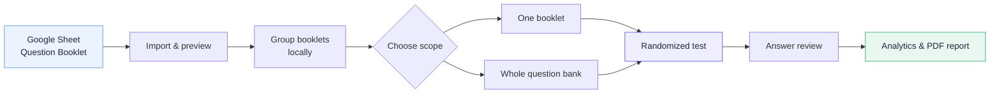

<div align="center">
  
  <h1>QuizForge</h1>
  <p><strong>Turn a Google Sheet into focused practice.</strong></p>
  <p>Build randomized question-booklet tests, review every answer, understand your weak areas, and export polished reports—all in the browser.</p>

  
  
  
  
</div>

## Why QuizForge?

QuizForge is a privacy-first, browser-based quiz workspace for learners, teachers, tutors, exam aspirants, and training teams. Bring the question bank you already maintain in Google Sheets, save each imported tab as a **Question Booklet**, combine booklets into a **Question Bank**, and turn them into useful practice sessions.



## Repository highlights

| Area | What it includes |
| --- | --- |
| Question booklets | Import Google Sheets tabs, preview rows, rename booklets, group them, refresh from source, and manage questions with CRUD controls. |
| Practice tests | Select one booklet or the whole question bank, filter by subtopic and difficulty, shuffle questions, and shuffle options while keeping visible labels A–D. |
| Question metadata | Preserve subtopic, speciality, difficulty, explanations, positive marks, and negative marks from the source sheet. |
| Results | Review correct answers on demand, see correct/incorrect/skipped counts, inspect subtopic and difficulty analytics, and download a detailed PDF. |
| AI question generator | Create a ready-to-copy NTA JEE Main prompt for Physics, Chemistry, and Mathematics batches with a QuizForge-compatible 10-column schema. |
| Privacy | No account or QuizForge server is required. Question booklets, attempts, settings, and unfinished tests stay in browser storage. |
| Experience | Responsive layout for phones, tablets, and desktop; friendly loading state; cute 404 page; dark mode; feedback form; and donation page. |

## Useful use cases

- **JEE Main preparation:** Generate Physics, Chemistry, or Mathematics batches with difficulty 1–5, chapter metadata, and historical recurrence speciality.
- **RPSC, RSSB, UPSC, and SSC practice:** Build subject-wise or current-affairs booklets from a trusted Sheet.
- **Teachers and tutors:** Maintain a master Sheet, create differentiated tests, and share readable performance reports.
- **Interview preparation:** Store Java, Python, SQL, system-design, or domain-specific questions as reusable booklets.
- **Language learning:** Practice vocabulary, grammar, comprehension, and translation with subtopic-level analytics.
- **Corporate training:** Turn onboarding, product, compliance, or process questions into local browser practice.
- **Homeschooling and self-study:** Keep private subject booklets and export backups without setting up an LMS.

## Google Sheets question-bank format

Use one header row. Header matching is case-insensitive. The recommended 10-column format is:

| Column | Purpose | Example |
| --- | --- | --- |
| `SN` | Sequential question number or ID | `121` |
| `Question` | Question text | `A charged particle enters...` |
| `Option A` | First answer choice | `2 V` |
| `Option B` | Second answer choice | `4 V` |
| `Option C` | Third answer choice | `8 V` |
| `Option D` | Fourth answer choice | `16 V` |
| `Answer` | Correct option letter | `C` |
| `Difficulty Level` | Value from 1 to 5 or a label | `3` |
| `Subtopic` | Topic used for filters and analytics | `Physics - Electrostatics` |
| `Speciality` | Exam recurrence or question speciality | `JEE Main - 2021, 2023 and 2025` |

Optional columns are `Explanation`, `Marks`, and `Negative Marks`. Older booklets without `Speciality` remain compatible and display `Not specified` until edited.

### Supported AI-generated headers

The built-in AI prompt generator uses these exact labels:

```text
sn;question;option A;option B;option C;option D;answer(A,B,C,D);Difficulty level(1,2,3,4,5-most difficult);subtopic option;speciality
```

The importer understands both ordinary comma-separated CSV and semicolon-delimited CSV, as well as the corresponding Google Sheets headers.

## Getting started

### Requirements

- Node.js 18 or newer
- npm

### Run locally

```bash
npm ci
npm run dev
```

Open the local URL shown by Vite. To create a production build:

```bash
npm run build
npm run preview
```

## Import a booklet

1. Create the question-bank header row in Google Sheets.
2. Add one question per row and keep the answer as `A`, `B`, `C`, or `D`.
3. Open **Share → General access → Anyone with the link → Viewer**.
4. Copy the normal Google Sheets share URL, including the selected tab `gid` when needed.
5. Open **Import questions** in QuizForge, paste the URL, preview the rows, and save the Question Booklet in a group.

Publishing the Sheet to the web is not required. A private Sheet that requires sign-in cannot be read by the static browser app.

## AI question generator

Open **AI question generator** in QuizForge to customize the NTA JEE Main prompt:

- batch size and starting serial number;
- Physics, Chemistry, Mathematics, or a focused chapter selection;
- semicolon-delimited CSV or Markdown output;
- exact answer, difficulty, subtopic, and speciality rules;
- calculation checks and distractors based on common student errors.

QuizForge does not call an AI service or upload your content. Copy the prompt into your preferred AI tool, paste the generated output into Google Sheets, share it as Viewer, and import it as a Question Booklet.

## Privacy and security model

QuizForge is a static, local-first web app:

- question booklets, attempts, settings, and unfinished tests are stored in IndexedDB or LocalStorage;
- no QuizForge account or study-history server is required;
- Settings provides JSON export, restore, history reset, and complete local-data deletion;
- imported content is validated and length-limited before it is stored or rendered;
- PDF results are generated in the browser;
- Google Sheets access is view-only and uses a public link supplied by the user.

Keep your device, browser profile, shared Sheets, exported JSON backups, and PDF reports private. QuizForge is intended for practice and self-assessment, not secure high-stakes examinations.

## GitHub Pages deployment

The repository includes `.github/workflows/deploy.yml`. It builds and deploys automatically whenever `main` changes.

1. Push the repository to GitHub.
2. Open **Settings → Pages**.
3. Set the build source to **GitHub Actions**.
4. Push to `main` or run the workflow manually from the **Actions** tab.

The Vite configuration automatically uses the GitHub repository name as the project-site base path. The workflow also sets `VITE_SITE_URL` and generates `robots.txt` and `sitemap.xml` for the resulting GitHub Pages URL.

## Project structure

```text
src/
├── App.jsx                 # Workspace layout, routes, pages, and UI flows
├── sheets.js               # Google Sheets/CSV parsing and validation
├── quiz.js                 # Test selection, shuffling, scoring, and analytics
├── pdf.js                  # Detailed browser-generated PDF reports
├── db.js                   # IndexedDB and LocalStorage persistence
├── styles.css              # Core responsive design system
├── ai-generator.css        # AI prompt builder styling
└── question-metadata.css   # Speciality and question metadata styling
public/
├── favicon.svg             # Shared QuizForge logo
└── donation-qr.png         # Donation QR visual
.github/workflows/
└── deploy.yml              # GitHub Pages build and deployment
```

## Contributing

1. Fork the repository.
2. Create a focused feature branch.
3. Run `npm run build` before opening a pull request.
4. Explain the user problem, implementation, and verification steps.

## License

Add the project license that matches how you want QuizForge to be shared and reused.
